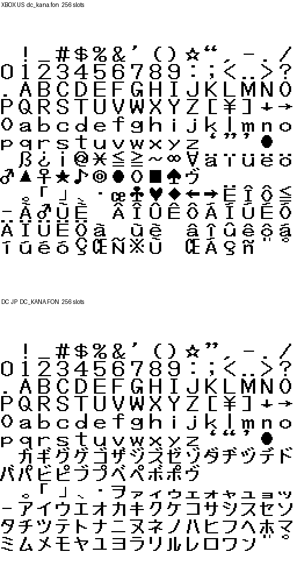
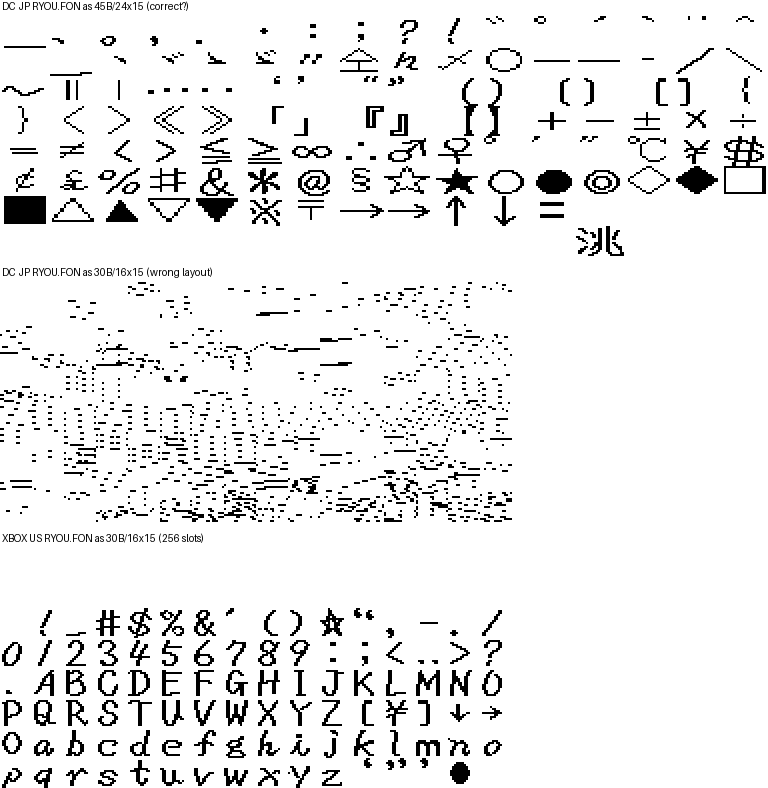

# Shenmue II (Xbox, US) — 字库与日文残留实测

对 Xbox 初代美版《莎木 II》四章合一版的数据层审计：字库是否为 DC 日版原样、字幕流里的残留日文与 DC 日版是什么关系、两者能否互为母本。

**本仓库只发布结论、脚本与统计指纹，不包含任何游戏原始数据（不含字库、不含文本、不含可执行文件）。**

- 样本：Shenmue II (Xbox, US) 解包目录；Shenmue II v1.003 (2001)(Sega)(NTSC)(JP) Disc 1–4 解包目录
- 方法：字节级哈希 + AFS/CHID 结构解析 + 内容对齐
- 全部数字由本仓库 `tools/` 现场产出，对应 `data/` 下的 CSV

---

## 摘要

美版 `misc` 里保留着 DC 日版那套 351,270 字节汉字库，且与日版四碟、与同目录 `COLD.BIN` 的内嵌段三处逐字节相同。但同目录的 `dc_kana.fon` 与 `RYOU.FON` 已被替换为 256 槽的西文小字库，原库不在美版里。字幕流方面，美版每条记录带一个 `EXTD` 段，装载日文原文；剔除自由对话与两个独立表后，主线／过场台词有 **99.84%** 与 DC 日版主文本逐字节相同，说明两边剧本同源，美版残留日文可直接作为引擎原生母本使用。

---

## 结论

### F1　汉字库三处同一

| 位置 | 大小 | MD5 |
|---|---|---|
| Xbox `misc/dc_kanji.fon` | 351,270 | `8669109EE72543CDEF91305A6D0CA018` |
| DC 日版 `MISC/DC_KANJI.FON`（Disc 1–4） | 351,270 | `8669109EE72543CDEF91305A6D0CA018` |
| Xbox `misc/COLD.BIN` @ `15328` 起 351,270 B | 351,270 | `8669109EE72543CDEF91305A6D0CA018` |

351,270 = 7806 槽 × 45 B（24×15 点阵）。四碟的日版文件彼此也完全相同，因此这不是"某碟偶然"，而是同一份资源被复制到三处。

> 旁证：DC 版这三件字库的文件名与尺寸在 DC 时代已属公开信息（TCRF 的 Shenmue 条目、DC 光盘文件表）。但「Xbox 美版 S2 的 `misc` 也带着同一份汉字库」在本仓库检索范围内未见公开记录。
>
> **生效位置**：2026-10-22 的 xemu 实机试验表明，三处之中**只有 `COLD.BIN@15328` 生效**——直接替换 `misc/dc_kanji.fon` 不改变字幕显示。三处字节相同，但只有一处被引擎读取。详见 [`docs/history.md`](docs/history.md)。

### F2　`dc_kana.fon` 不是原样：半角假名区被换成欧洲字符

两版都是 7,680 B = 256 槽 × 30 B（16×15）。逐槽比对：**174 槽相同、82 槽不同**，差异槽为 `43`、`124`、`129–153`、`166–175`、`177–221`。

| 槽区 | DC 日版 | Xbox 美版 |
|---|---|---|
| 0–42 / 其余 ASCII | 拉丁字母、数字、标点 | 基本相同 |
| 43 (`+`)、124 (`\|`) | 单槽字形不同 | — |
| 129–221 | 半角片假名（ｶﾞ ﾓ ｼﾞ ｻ ﾃｨ …） | `Á â ü è é ë` 等欧洲重音字母 + `▲ ★ ☎ ✿ ◆ ■ ♠ ♣ ↓ →` 图形符号 |

即：为英／法／德字幕准备的西文扩展表。



逐槽数据：[`data/kana_slot_diff.csv`](data/kana_slot_diff.csv)（`slot, same, xbox_md5, dc_md5`）。

### F3　`RYOU.FON` 第二套汉字库被整体丢弃

| | 大小 | 槽数 | MD5 |
|---|---|---|---|
| DC 日版 | 351,270 | 7806 × 45 B（24×15） | `B64E8F3A97DE4A987574B526EF101CB0` |
| Xbox 美版 | 7,680 | 256 × 30 B（16×15） | `66E52ECC0DE45F0D9E36E901FD711216` |

- 美版这 7,680 B 在 DC 的 351,270 B 里找不到任何连续匹配片段（`find` 返回 `-1`）。
- 也不等于 `DC_KANJI.FON` 的首段或尾段 7,680 B。
- DC 那份是 **7,806 槽的第二套完整汉字库**，与 `DC_KANJI.FON` 分工互补，不是符号表：
  - DC 汉化版实测：81 种字形槽在 KANJI 中为空、在 RYOU 中有字，合计命中 12,231 次；两库皆空的只有 1 种（`A1A1` 顿号，249 次）。
  - 汉化 KANJI 与汉化 RYOU 有 3,704 / 7,806 槽字形不同。
  - 早期按 45 B/槽渲染时误判为「符号 + 部件表」，上述计数推翻了该判断。

结论：美版只保留了汉字库，RYOU 这套互补字库被换成了一张 256 槽 ASCII 表。若游戏某处（招牌、名牌、大字标题，或 KANJI 缺字的场合）调用它，字形只能从 DC 日版取回。



数据：[`data/ryou_analysis.csv`](data/ryou_analysis.csv)。

### F4　`EXTD` 残留日文与 DC 日版同源

美版 STREAM 的每条记录在英文主文本之后带一个 `EXTD` 子标签，装载日文原文。按内容对齐后的全量结果：

| 分组 | 文件数 | 日文台词（≥10 B） | 与 DC 逐字节相同 | 命中率 |
|---|---|---|---|---|
| 主线／过场（其余） | 334 | 12,840 | 12,819 | **99.84%** |
| FREE01–04（自由对话） | 4 | 30,237 | 27,774 | 91.85% |
| `0137.afs`（独立表） | 1 | 64 | 0 | 0.00% |
| `S2BV.afs`（独立表） | 1 | 27 | 0 | 0.00% |
| **合计** | **340** | **43,168** | **40,593** | **94.03%** |

- 主线／过场几乎完全一致，直接印证"美版残留日文＝DC 日版母本"。
- 差异集中在 FREE 系列：这 4 个文件是自由对话／随机闲聊池，两平台收录量不同（DC 记录 98,913 条 vs 美版 EXTD 台词 43,168 条），应视为**版本内容差异**而非翻译改动。
- `0137`／`S2BV` 全不命中，属独立表（人名表／影像相关），与剧本无关。
- 另有 2,459 条 EXTD 非日文（英文，如 `Okay.＆Goodbye.`），不计入。

样本（`0005.afs` / `RYO_STDL` / 第 0 条，两侧同为 20 字节）：

```
A5 EF A5 F3 A5 C1 A5 E3 A5 A4   A1 C4   B9 C8 C6 EE B3 B9   A1 C4
A1 F5   B2 B8 C5 C4 CF B0   A1 C4
```

即 `ワンチャイ…紅南街…<换行>恩田楼…`，DC 与 Xbox 完全相同。

### F5　符号语义更正：`A1C4` 是省略号，`A1F5` 是换行

早期笔记曾把 `A1C4` 记作顿号、`A1F5` 记作「＆」，于是误以为两平台标点体系不同。实测与实机验证均为：

| 字节 | 含义 | 说明 |
|---|---|---|
| `A1C4` | `…` 省略号 | 句尾停顿 |
| `A1F5` | **换行** | 字幕按此显式断行 |
| `A1A1` / `A1A2` | 顿号类 | 句中分隔 |

xemu v0.8.138 实机字幕：同一句显示为两行 `ワンチャイ…紅南街…` / `恩田楼…`，正是 `A1C4` 出省略号、`A1F5` 断行的结果；相邻句 `桃李少老師は、ここに…` 同时含顿号与省略号，进一步区分了两类符号。

因此：**两平台符号体系一致**。旧记录里的 `…` 和 `/` 分歧，是把换行符 `A1F5` 可读化成斜杠造成的误读。

---

## 方法

### 数据形态

| 层 | Xbox 美版 | DC 日版 |
|---|---|---|
| 容器 | `AFS\0` + 小端 entry 表（offset/length） | 同格式 |
| 记录 | `CHID` 标签 + speaker + 子标签偏移 + 主文本 + `EXTD`/`CLIP` 子段 | `CHID` + speaker + 主文本（无 `EXTD`） |
| 文本编码 | EUC-JP 字节，字库槽位寻址 | EUC-JP |
| 字库 | `misc/dc_kanji.fon`、`dc_kana.fon`、`RYOU.FON`、`COLD.BIN` | `MISC/` 下同名文件 |

记录结构详见 [`docs/afs-format.md`](docs/afs-format.md)。

### 为什么必须"按内容对齐"

三种口径的结果差异很大，本仓库最终采用第三种：

| 口径 | 台词命中率 | 问题 |
|---|---|---|
| 按记录序号对齐 | 71.68% | 两平台记录条数／顺序不同，`0102.afs` 出现 2→3、3→4 整体偏移，`0015.afs` 整段位移，把同文件内的句子误判成改动 |
| 内容对齐，不判语种 | 51.44% | EXTD 含大量英文段与短名条目，被算成 miss |
| 内容对齐 + 语种判定 + 分层 + 文件去重 | 94.03%（主线 99.84%） | 采用 |

语种判定在字节层完成：出现 EUC 假名区（`A4xx`/`A5xx`）或汉字区（`B0xx–FExx`）即视为日文，纯 ASCII 段归为非日文。

归一化仅去除尾部填充：`00`、`20`、以及重复的全角空格 `A1A1`，避免"只差尾随空白"被误判。

### 分层

- **台词级**：归一化后 ≥ 10 字节（5 个双字节字符以上），主结论口径。
- **短条**：< 10 字节，几乎全是人名、名牌、单词应答（如 `涼`、`ジョーンズ`、`失せな！`），DC 侧多存放在别处（名牌/HUMANS 一类），命中率仅 5.55%，**不代表文本不一致**，故单列不计入主结论。

---

## 复现

环境：Windows + Python 3.10+（仅标准库）。两套解包目录需自备（本仓库不含数据）。

```bash
# 1. 字库指纹 / 槽级差异 / RYOU 结构
python tools/font_audit.py --xbox "<XBOX_ROOT>" --dc "<DC_ROOT>" --outdir data

# 2. 全量 EXTD 对齐（内容口径 + 语种判定 + 去重）
python tools/extd_align.py --xbox "<XBOX_ROOT>" --dc "<DC_ROOT>" \
    --out data/extd_align_summary.csv --detail data/extd_miss_long.csv

# 3. 分组汇总 + 短条抽样
python tools/breakdown.py --summary data/extd_align_summary.csv \
    --out data/extd_breakdown.csv

# 4. 单文件快查
python tools/afs.py "<XBOX_ROOT>/scene/01/stream/0005.afs"
```

目录约定：Xbox 侧 `<XBOX_ROOT>/scene/<01..04>/stream/*.afs`，DC 侧 `<DC_ROOT>/<1..4>/SCENE/<01..04>/STREAM/*.AFS`。同一 AFS 会在多碟目录重复出现，脚本已按文件名去重。

期望输出（与 `data/` 一致）：

```
files             : 340
DC records        : 98913
非日文 EXTD        : 2459
日文台词 >=10B     : 43168  hit 40593 (94.03%)
日文短条 <10B      : 42411  hit 2355 (5.55%)
```

---

## 数据文件

| 文件 | 内容 |
|---|---|
| `data/font_fingerprints.csv` | 各字库文件的大小与 MD5（Xbox / DC 四碟 / COLD 内嵌段） |
| `data/kana_slot_diff.csv` | `dc_kana` 256 槽逐槽一致性（slot, same, 两侧槽 MD5） |
| `data/ryou_analysis.csv` | RYOU 长度、槽数、前缀/后缀比对、DC 内查找结果 |
| `data/extd_align_summary.csv` | 340 个 AFS 的逐文件统计 |
| `data/extd_breakdown.csv` | 按文件组归并的命中率 |
| `data/extd_miss_long.csv` | 台词级未命中 2,575 条（含文本与 hex，便于定位） |
| `data/short_samples_FREE01.tsv` | FREE01 短条抽样，用于判读短条性质 |

---

## 与公开资料的边界

**已公开、不要当作首发**

- DC 版三个字库的文件名与尺寸；改 `DC_KANJI.FON` 解决特殊字符的做法（Shenmue Mods 教程，语境为 What's Shenmue）。
- Xbox 版字幕工程史（SHENTRAD 自 Xbox 版起步），Xbox 法语版（Shenmue Master/TRAF）与俄语版（Jabberwocky，基于 PC 俄化补丁）。
- 重制版语言槽位（670–689 简中 / 690–709 繁中 / 710–729 英 …，Shenmue Dojo「Subtitles Localization」帖）。
- 光盘内未使用日文对白（Phantom River Stone，对象是 Game Jam 原型／Miao Village 删减剧情）。

**本仓库未见公开记录的部分**

1. 美版 `misc` 保留 DC 日版完整汉字库，且与日版四碟、`COLD.BIN@15328` 三处 MD5 相同。
2. 美版将 `dc_kana.fon` 半角假名区替换为欧洲重音字母与符号（82/256 槽）。
3. 美版将 7806 槽 `RYOU.FON`（与 KANJI 互补的第二套汉字库）整体换成 256 槽 ASCII 表。
4. 美版 `EXTD` 与 DC 日版主线／过场台词 99.84% 字节同一。
5. 以该残留日文直接作为 Xbox 侧日文母本使用。

> 「未见公开记录」指公开可检索渠道（Web／论坛／GitHub／知识库）；Discord 与未被索引的私帖不在范围内，故宜表述为「未见记录」，而非「无人做过」。

---

## 对汉化工程的意义

| 项 | 结论 |
|---|---|
| 汉字库 | 写 **`COLD.BIN@15328`（351,270 B）**；**不要写 `misc/dc_kanji.fon`**，实机证明无效 |
| 换库前提 | 字库替换必须与全量文本转码同步：只换库时未译日文句会批量显示错字（`桃李少老師`→`洪李绪老点`），不能日中混排 |
| 半角字库 | 不可复用：美版是西文表；中文版主要走全角汉字库，影响有限 |
| RYOU 字库 | 缺失：美版只剩 256 槽；需从 DC 日版取回整套 351,270 B（与 KANJI 互补，非符号表） |
| 日文母本 | 可直接用：与 DC 原盘字节一致，无需符号转换 |
| 字幕排版 | 换行由 `A1F5` 显式控制，中文写盘须自行断行，不能依赖自动折行 |
| 贴图文字 | 纸条／招牌为 SPR 贴图层，不属文本表，需单独重绘 |
| 分章字库 | 四张汉化盘 `DC_KANJI.FON` 的 md5 不同（Disc1 / Disc2+4 / Disc3 三组），按章选库或先合并字形集 |

---

## 局限

- 仅覆盖 Xbox **美版**（US）与 DC **日版**（NTSC/J, v1.003）。欧版（PAL）的 `Cool J → Cool Z`、Yuan 相关改写未纳入。
- 短条层（<10 B）未与 HUMANS／名牌表做交叉比对，其"DC 侧存放在别处"为结构推断，尚待单独验证。
- `0137`／`S2BV` 未命中原因未逐条定性，仅判定为独立表。
- 未做 DVD／ISO 层校验（本仓库基于解包目录，非原始媒体镜像）。

---

## 合规

本仓库不含任何 Sega 拥有版权的资源：无字库二进制、无文本表、无可执行文件、无图像素材。`assets/` 下两张图是由**哈希与点阵统计**重新渲染的字形示意，用于说明槽位差异。

---

## 许可

- **代码**（`tools/` 下全部脚本）：MIT，见 [`LICENSE`](LICENSE)。
- **文档**（`README.md`、`docs/` 下全部文件）：CC BY 4.0，转载或引用须署名 **FibrizoReturns**（Bilibili `@FibrizoReturns`）并注明来源。

商业使用代码不受限制；文档的商用需保留署名。

## 致谢

- Shenmue Dojo 社区关于 Xbox 字幕与语言槽位的历史讨论。
- TCRF、Shenmue Mods 等对 DC 版字库文件名的公开记录，为本次对照提供了起点。
